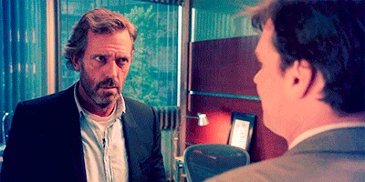
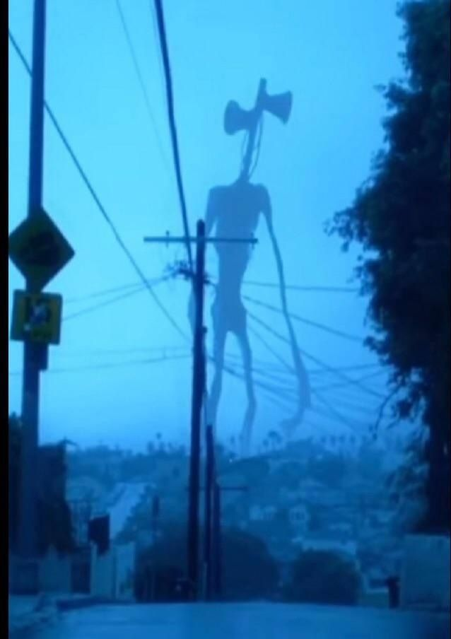
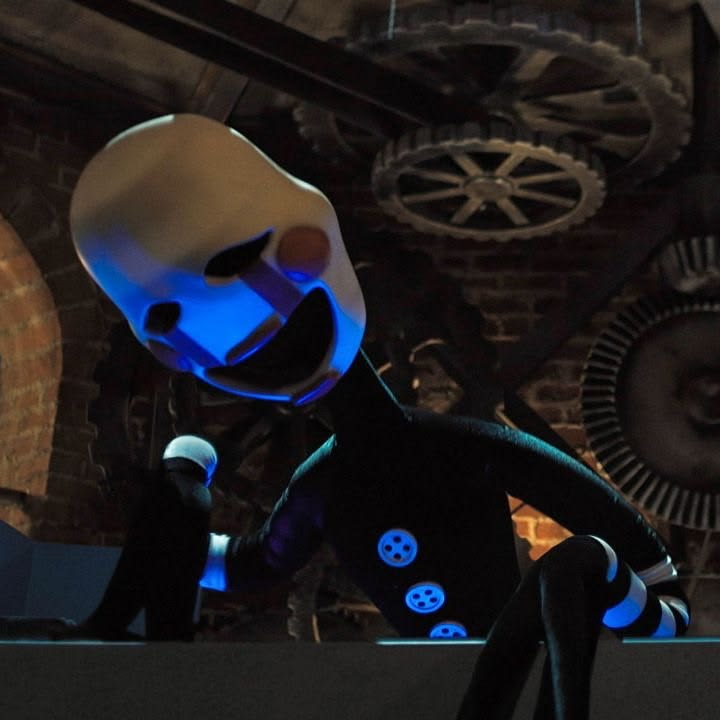
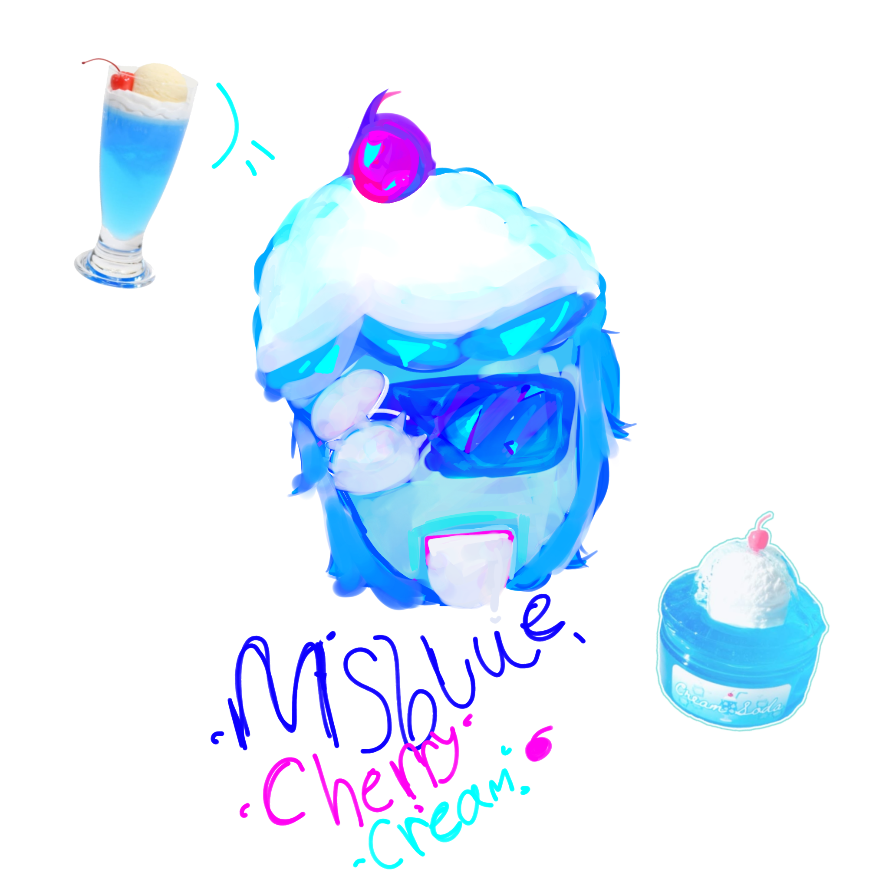
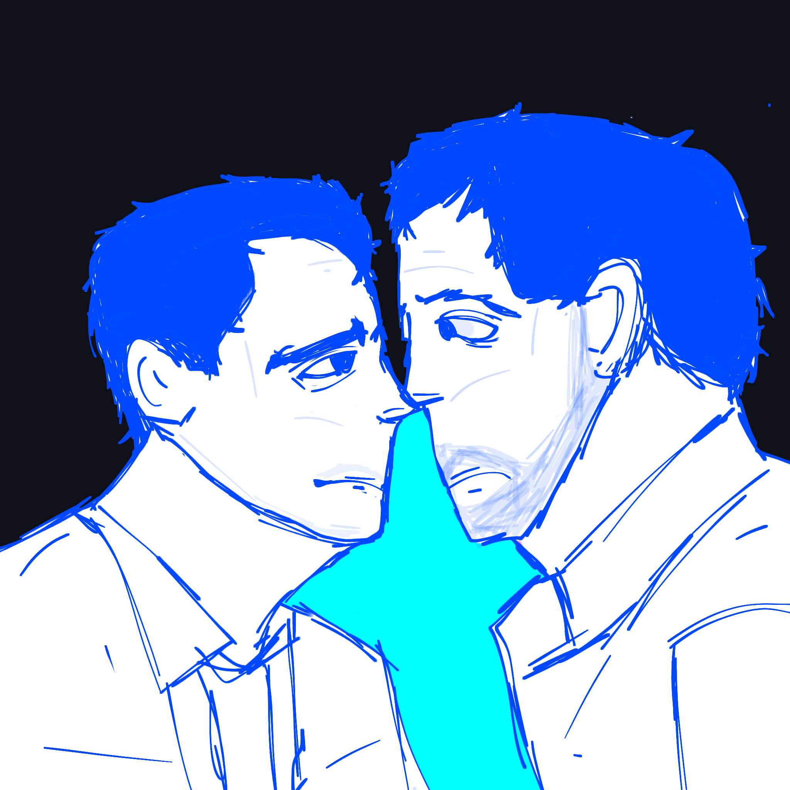
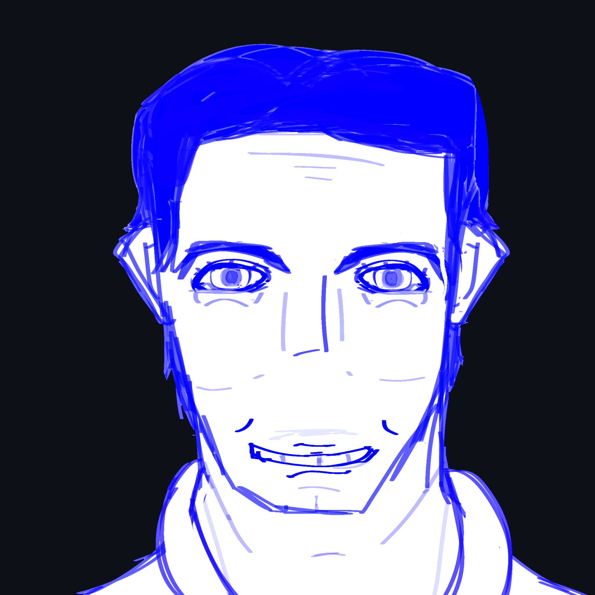
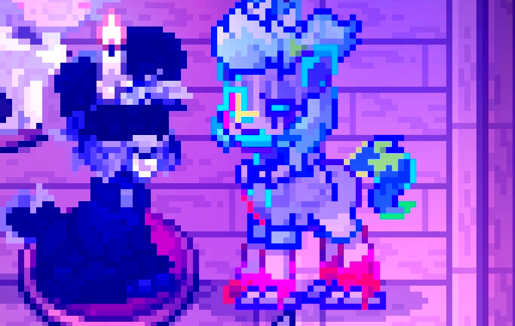

  <!-- الـ GIF محاذى لليسار بحجم أكبر ومستطيل -->
  

 

<!-- نص الفاندومز بالطول وبالخط العادي -->

  $$\color{#0000FF}{\mathit{Fandoms:\ currently\ watching\ House\ MD\ and\ maybe\ a\ dogman\ comic\ books\ lover,}}$$
  $$\color{#0000FF}{\mathit{I\ love\ horror\ games\ by\ all\ types\ especially\ baldi's\ basics,\ slendytubbies,}}$$
  $$\color{#0000FF}{\mathit{hello\ neighbor,\ and\ Fnaf,\ Slenderman,\ analog\ horror,\ SCP,\ and\ The\ backrooms,}}$$
  $$\color{#0000FF}{\mathit{in\ addition\ to\ EVREY\ cartoon\ show,\ OK.\ Ko,\ mao\ mao,\ etc,\ yeah\ btw\ I\ don't}}$$
  $$\color{#0000FF}{\mathit{really\ like\ tadc\ whatever..}}$$

<!-- خط فاصل ومسافة تحت النص الأزرق -->
 

 

<!-- الصورتين على اليمين -->

  
  

<!-- نص الـ DNI بالطول باللون البنفسجي #5500FF -->

  $$\color{#5500FF}{\mathit{Dni:\ if\ you\ make\ ponies\ include\ boobs\ or\ inappropriate\ looks\ or\ if\ you\ do\ sexual\ jokes}}$$
  $$\color{#5500FF}{\mathit{thinking\ they're\ funny,\ and\ library\ people\ DO\ not\ touch\ me\ you\ guys\ are\ gross\ (not\ evreyone}}$$
  $$\color{#5500FF}{\mathit{included\ but\ most\ of\ you\ are,\ specially\ on\ that\ red\ side\ of\ the\ library),\ also\ people\ who}}$$
  $$\color{#5500FF}{\mathit{make\ child\ sexual\ abuse\ jokes,\ do\ not\ touch,\ same\ goes\ for\ people\ who\ make\ jokes\ about}}$$
  $$\color{#5500FF}{\mathit{disabled\ people\ or\ skin\ racism\ I\ block\ freely\ most\ of\ you\ all\ and\ make\ fun\ of\ you,}}$$
  $$\color{#5500FF}{\mathit{I\ simply\ don't\ really\ give\ a\ shit}}$$

<!-- خط فاصل ومسافة -->
 

 

<!-- الصورة الجديدة الكبيرة جداً لوحدها في السطر -->

  

<!-- خط فاصل ومسافة -->
 

 

<!-- الصورة في المنتصف -->

  

<!-- خط فاصل أفقي عادي -->
 

 

<!-- الصورتين جنب بعض وبينهم خط فاصل رأسي (عمودي) -->

  
  
  

<!-- خط فاصل تحت الصورتين -->
 

 

<!-- الصورة الأخيرة بحجم أصغر ومناسبة وفي المنتصف -->

  

<!-- النص المزخرف (Slowly Losing Temper) مع الزخرفة اللي فوق باللون الأسود واللي تحت باللون الأبيض -->

  $$\color{#000000}{\text{✧\ ───\ ✦\ ───\ ✧}}$$
   
  $$\color{#808080}{\text{𓆩\ ──\ }}\color{#00FFFF}{\text{°✧•.\ }}\color{#808080}{\text{˚✧~ }}\color{#00FFFF}{\mathit{SLOWLY\ }}\color{#5500FF}{\mathit{LOSING\ }}\color{#00FFFF}{\mathit{TEMPER}}\color{#808080}{\text{ ~✧˚}}\color{#5500FF}{\text{\ .•✧°}}\color{#5500FF}{\text{\ ──\ 𓆪}}$$
   
  $$\color{#FFFFFF}{\text{✧\ ───\ ✦\ ───\ ✧}}$$

